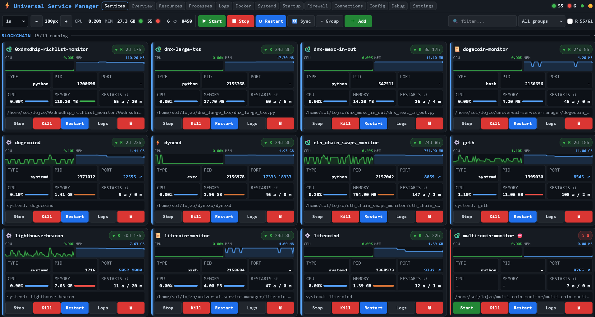
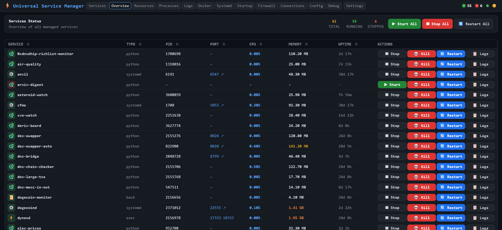
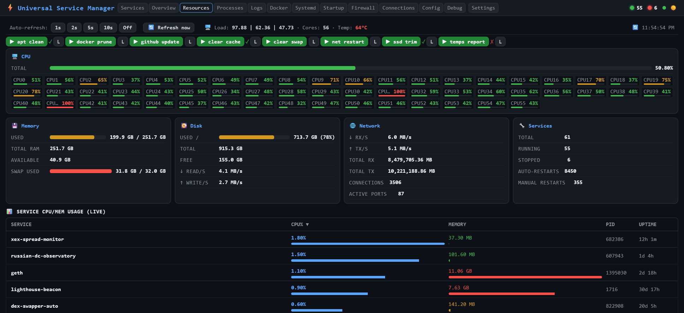
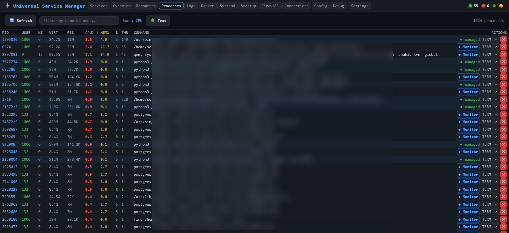
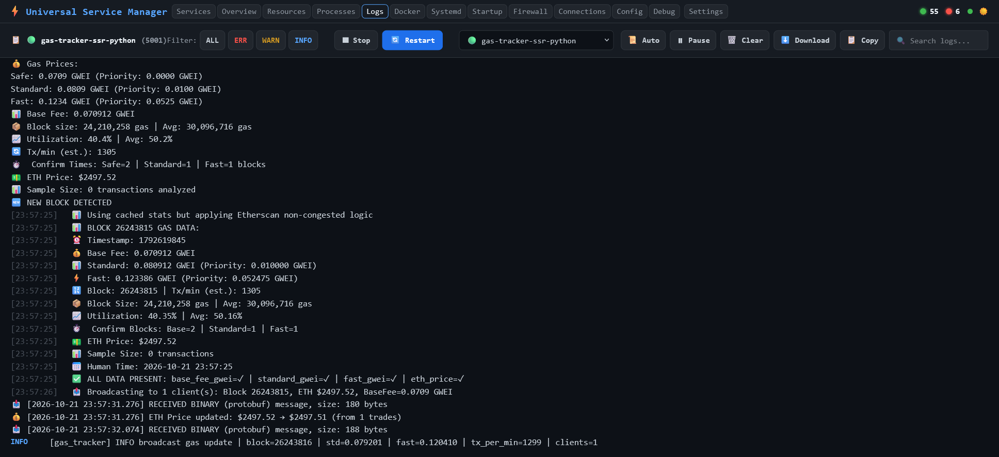
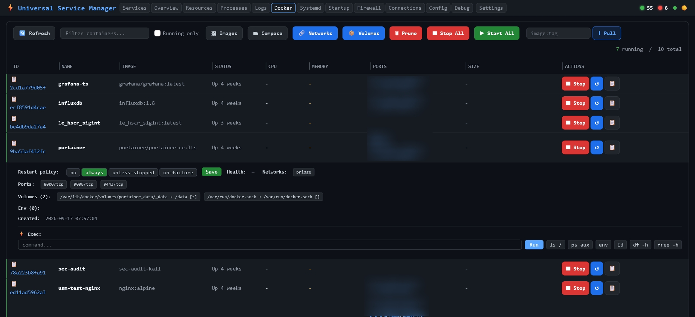
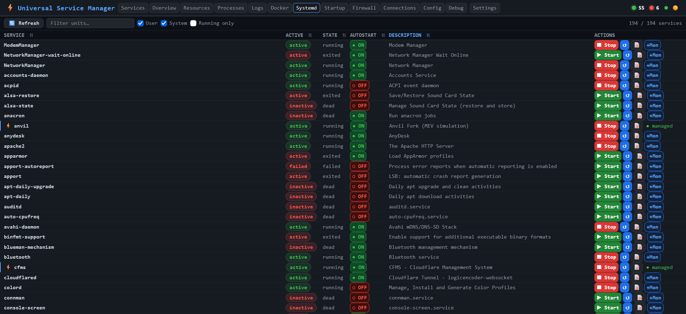
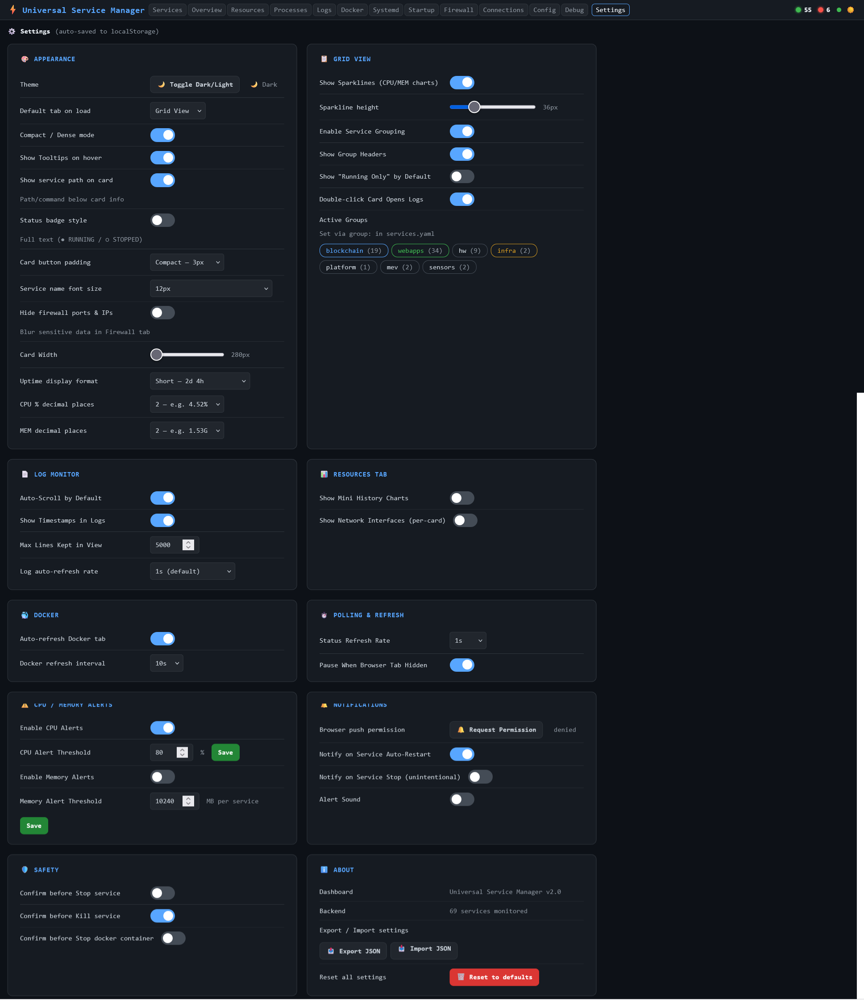

# Universal Service Manager

Managing a growing collection of applications can turn a simple check into a round of terminal sessions, log searches and separate administration tools. Universal Service Manager grew out of that daily frustration: the available tools did not fit the way its creator wanted to work, so a single workspace was built around those needs.

The result brings service control, logs, resource monitoring, containers and host administration together. See what needs attention, investigate it and take action without repeatedly changing tools. Less time navigating between utilities means more time spent on the applications themselves.

## Tech stack

| Layer | Technologies |
|---|---|
| Application | Python |
| Dashboard | HTML, CSS, JavaScript |
| Configuration | YAML |
| Monitoring | psutil, Server-Sent Events |
| Integrations | Docker, Docker Compose, systemd, SSH, UFW |
| Platform | Linux |

## A single place to run the fleet

The **Services** workspace makes a mixed collection of applications manageable as one fleet. Python applications, Node.js tools, shell jobs and native services appear together, with clear running or stopped states and the controls needed for everyday administration.

Each card brings status, resource usage, uptime and restart activity into the same view. Open the service's logs, start it, stop it or restart it without searching for its launch command. Recent usage charts help distinguish a quiet application from one whose resource needs are changing.

Groups organise related services, while search and running-only filters keep large fleets navigable. Card sizing, collapsible groups and a saved display order let the workspace fit the operator's routine. Individual and group actions support focused work as well as broader maintenance.

## A compact overview for busy hosts

The **Overview** table presents the same fleet in a denser layout. It is useful when the priority is comparing services rather than working with individual cards: scan running states, sort by resource usage and find the application that deserves attention.

Lifecycle controls remain available beside each row, so identifying a problem and acting on it stay in the same workspace. Summary counts make it easier to check the overall fleet after maintenance.

## Understand where resources are going

The **Resources** workspace helps answer a practical question: is one application struggling, or is the whole machine under pressure? CPU activity, memory, storage and network information sit together, with a service usage table that helps identify the largest consumers.

Per-core activity and recent trends provide context beyond a single percentage. Memory and swap information help explain pressure, storage usage shows capacity concerns, and transfer rates help identify network activity. Available sensor and interface information adds detail where the host supports it.

Choose an update rate appropriate to the investigation or refresh on demand. This keeps the information useful during an incident without requiring another monitoring tool for a quick diagnosis.

## Inspect processes and bring them into view

The **Processes** workspace shows what is actually running on the host, including processes outside the managed fleet. Search, sorting and a tree view help identify a busy application and understand which processes belong together.

Managed entries are highlighted. **+ Monitor** provides a route to bring an existing workload into the service workspace, reducing the effort of registering something already running. Termination controls support deliberate cleanup when a process needs to be stopped.

## Follow logs while taking action

The **Logs** workspace keeps investigation beside service control. Select an application, read its output and narrow the view to warnings or errors. Start, stop and restart controls remain available while following the selected service.

Pause and autoscroll make it practical to switch between watching new output and reading a particular failure. Search helps locate relevant text, while copy and download controls make it easier to share findings or keep an incident record.

This shortens a common troubleshooting loop: find the affected service, inspect the failure, make the necessary correction and check its next start from one place.

## Manage containers alongside applications

The **Docker** workspace brings container workloads into the same daily routine as the rest of the fleet. Inspect state, resource use, exposed ports and recent output, then act on the selected container without opening a separate container manager.

Image browsing, restart policies and command execution support deeper investigation. Network and volume views help explain a container's surroundings, while image and cleanup controls assist routine maintenance.

**Compose** controls address applications made up of several containers. Discover available projects, inspect their output and use project-level actions when the task concerns the whole stack. Confirmation and result messages help keep the scope of an operation visible.

## Work with native services

The **Systemd** workspace covers native system and user services. Search and scope filters make it easier to find the relevant unit, check whether it is active and control its lifecycle.

Boot enablement and journal access sit beside service actions, connecting the immediate problem with the service's longer-term behaviour. Existing units can also be brought into the managed fleet, keeping frequently used workloads accessible from the main workspace.

## Know what starts with the machine

The **Startup** workspace gathers boot-related information that would otherwise require checking several places. Native services, managed applications, scheduled startup jobs and other available boot mechanisms can be reviewed together.

Filters help focus on important or managed entries. This is useful before maintenance and after adding an application: check how it is expected to return after a reboot and whether its startup behaviour matches the intended role.

## Keep network administration close at hand

The **Firewall** workspace offers a view of firewall state and rules alongside the applications they affect. Inspect allowed or blocked traffic, adjust policies and maintain rules without leaving the dashboard.

Rule controls and recent firewall logs help investigate connectivity problems. Privacy preferences can obscure sensitive network information during demonstrations or screen sharing. Availability and permitted actions depend on the host's firewall setup.

## Check connections and move files

The **Connections** workspace reduces the friction around remote administration. Review configured destinations, check reachability and see whether the expected connection identities are available before spending time troubleshooting a transfer.

A two-pane file browser puts local and remote directories side by side. Navigate folders, copy in either direction, upload or download files and follow transfer progress. Directory and removal controls cover routine file management within the same workspace.

Connection inventory, key information and tooling status help keep access organised. Explicit key-deployment and connection-sync controls support setup tasks when those changes are needed.

## Maintain the service registry

The **Config** workspace gives experienced operators one place to review and update service definitions. Validation helps catch configuration problems before applying an edit, and visible feedback makes the result easier to assess.

An add-service form offers a more guided route for common additions. Together, these controls reduce the need to leave the dashboard for routine fleet maintenance while preserving direct access to the configuration when a more specific change is required.

## Make repeated problems easier to investigate

The **Debug** workspace collects health summaries, active resource alerts, restart leaders and recent action results. It helps identify patterns such as one application repeatedly failing or a resource threshold being exceeded.

Event details add context to the current service state. Instead of relying only on whether a card is green now, the operator can review recent actions and failures to decide what needs a closer look.

## Shape the workspace around the routine

**Settings** lets the dashboard adapt to the person using it. Choose a theme and density, adjust cards and charts, set preferred update behaviour and decide which details remain visible.

Log preferences, resource alerts, notifications and confirmation prompts support different working styles. Privacy options help during screen sharing, while preference export and import make it easier to carry a familiar layout to another browser.

These choices make a frequently used administration screen more comfortable and reduce repetitive setup.

## Less switching in everyday operations

A typical investigation can begin with a stopped service in the grid, continue through its logs and resource usage, and end with a targeted restart and a health check. Container, native-service and connection tools remain nearby when the cause lies outside the application itself.

Automatic recovery supports eligible services that stop unexpectedly, while deliberate stops keep maintenance under the operator's control. A command-line interface also supports terminal-based work when a browser is unnecessary.

The central benefit is a shorter path from noticing a problem to understanding and resolving it: one familiar workspace for tasks that previously lived across several tools.

---

Private code: [universal-service-manager](https://github.com/logicencoder/universal-service-manager)

See [REPOS.md](REPOS.md) for related repositories.

**[Logic Encoder](https://logicencoder.com)** · [GitHub](https://github.com/logicencoder) · [Contact](https://logicencoder.com/contact/)
